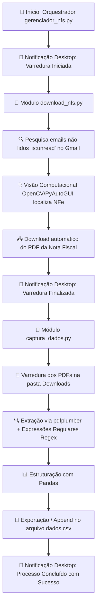

# 🤖 Armazenador de Dados de Clientes e Pagamentos (RPA)

[](https://www.python.org/)
[]()
[](https://github.com/astral-sh/uv)
[]()

> **Automação RPA (Robotic Process Automation)** completa para varredura de webmail, download automatizado de Notas Fiscais Eletrônicas (NFe) em formato PDF e extração estruturada de dados financeiros para planilhas CSV.

---

## 📌 Visão Geral

O **Armazenador de Dados de Clientes e Pagamentos** é uma solução de RPA desenvolvida em Python para otimizar o fluxo de trabalho de departamentos financeiros e de contabilidade. 

A ferramenta substitui o trabalho manual de abrir e-mails, baixar anexos de Notas Fiscais e digitar informações em planilhas. Através da combinação de **Visão Computacional**, **Processamento de PDFs (OCR/Parsing)** e **Notificações Desktop**, o robô executa a rotina do início ao fim com alta precisão e velocidade.

---

## ⚡ Fluxo da Automação (Workflow)



---

## 🎯 Funcionalidades Principais

- **📧 Varredura Inteligente de E-mails:** Identifica automaticamente e-mails de Notas Fiscais Eletrônicas pendentes de leitura usando filtros no webmail (`is:unread`).
- **👁️ Visão Computacional (RPA):** Localização dinâmica de botões, anexos e barras de pequisa em tela através de casamento de imagens (`PyAutoGUI` + `OpenCV`).
- **📄 Extração Estruturada de PDF:** Leitura profunda dos documentos PDF (`pdfplumber`) e extração precisa via Regex dos seguintes campos:
  - **CNPJ** do emitente
  - **Razão Social / Emitente**
  - **Data do Documento**
  - **Status do Pagamento**
  - **Descrição dos Serviços**
  - **Valor Total (R$)**
- **📊 Consolidação de Dados:** Gravação acumulativa automática em formato CSV (`dados.csv`), pronto para importação em ERPs, Excel ou Power BI.
- **🔔 Notificações em Tempo Real:** Informa o usuário no desktop sobre o andamento e conclusão de cada fase do processo (`notify-py`).
- **💻 Compatibilidade Multiplataforma:** Suporte a sistemas **Linux** (`posix`) e **Windows** (`nt`), mapeando dinamicamente o diretório de Downloads de cada SO.

---

## 🗂️ Estrutura do Projeto

```text
armazenador_de_dados_clientes_pagamento/
├── src/
│   ├── __init__.py
│   ├── gerenciador_nfs.py   # 🟢 Ponto de entrada / Orquestrador da automação
│   ├── download_nfs.py      # 🟡 Módulo de RPA (Navegação GUI, Visão Computacional e Downloads)
│   └── captura_dados.py     # 🔵 Módulo de Data Extraction (Parsing de PDF e gravação em CSV)
├── img/                     # 🖼️ Imagens de referência para o PyAutoGUI / OpenCV
│   ├── barra_pdf.png
│   ├── botao_download.png
│   ├── imagem_clicar.png
│   ├── imagem_inicial.png
│   └── pesquisar_email.png
├── user_gmail/              # 🌐 Perfil de sessão do navegador (Cookie/Session)
├── pyproject.toml           # 📦 Configurações de projeto e dependências (UV / Pip)
├── uv.lock                  # 🔒 Trava de dependências determinística
└── README.md                # 📖 Documentação do projeto
```

---

## 📊 Estrutura do Arquivo Gerado (`dados.csv`)

Os dados extraídos das Notas Fiscais são organizados com o seguinte esquema:

| Coluna | Descrição | Exemplo |
| :--- | :--- | :--- |
| `cnpj` | CNPJ da empresa emitente | `12.345.678/0001-90` |
| `emitente` | Razão Social ou Nome do Emitente | `Empresa de Serviços LTDA` |
| `data` | Data de emissão do documento | `15/10/2026` |
| `status_pagamento` | Situação do pagamento informado na nota | `Pago` / `Pendente` |
| `descricao` | Detalhamento dos serviços prestados | `Desenvolvimento de Software` |
| `valor` | Valor total da Nota Fiscal em R$ | `1500,00` |

---

## 🛠️ Tecnologias Utilizadas

- **[Python 3.14+](https://www.python.org/)** — Linguagem base da automação.
- **[PyAutoGUI](https://pyautogui.readthedocs.io/)** & **[OpenCV](https://opencv.org/)** — Automação de interface gráfica e visão computacional.
- **[pdfplumber](https://github.com/jsvine/pdfplumber)** — Extração de texto legível de arquivos PDF.
- **[Pandas](https://pandas.pydata.org/)** — Manipulação, estruturação e exportação dos dados.
- **[notify-py](https://pypi.org/project/notify-py/)** — Sistema de notificações desktop nativas.
- **[uv](https://github.com/astral-sh/uv)** — Gerenciador de pacotes e ambientes virtuais ultrarrápido em Python.

---

## 🚀 Como Executar o Projeto

### Pró-requisitos

- Python 3.10 ou superior instalado.
- Gerenciador de pacotes **[uv](https://github.com/astral-sh/uv)** (recomendado) ou `pip`.

### 1. Clonar o repositório

```bash
git clone https://github.com/seu-usuario/armazenador-de-dados-clientes-pagamento.git
cd armazenador-de-dados-clientes-pagamento
```

### 2. Configurar o Ambiente e Instalar Dependências

**Utilizando `uv` (Recomendado):**
```bash
# Sincroniza e instala o ambiente virtual automaticamente
uv sync
```

**Utilizando `pip` convencional:**
```bash
python -m venv .venv
source .venv/bin/activate  # Linux/macOS
# ou: .venv\Scripts\activate  # Windows

pip install pdfplumber pandas pyautogui mss opencv-python notify-py playwright
```

### 3. Execução da Automação

Antes de rodar, certifique-se de que a janela do seu navegador com o Gmail esteja aberta na tela principal para que o PyAutoGUI possa localizar os elementos visuais.

Execute o script orquestrador principal:

```bash
# Com uv
uv run python src/gerenciador_nfs.py

# Ou direto via ambiente ativo
python src/gerenciador_nfs.py
```

---

## ✒️ Autor

Desenvolvido por **Luann Santos**.

---
*Projetos RPA — Automação Inteligente de Processos.*
